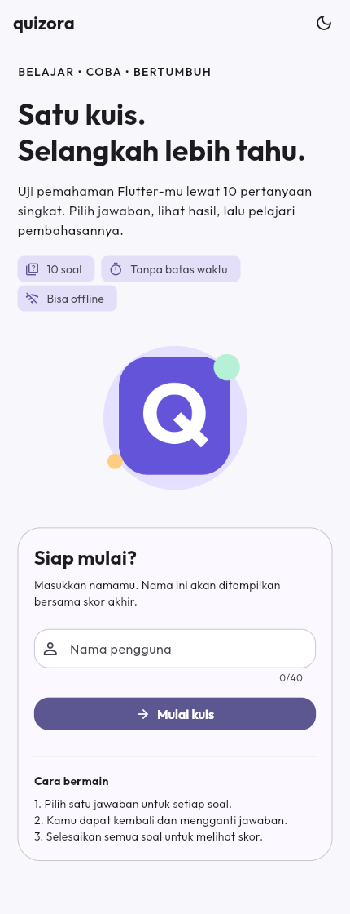
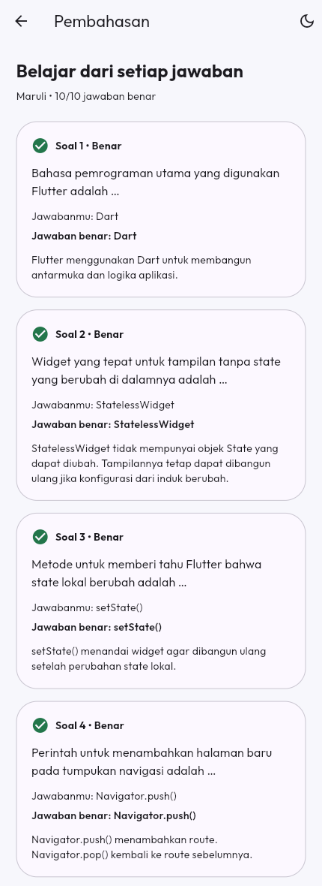
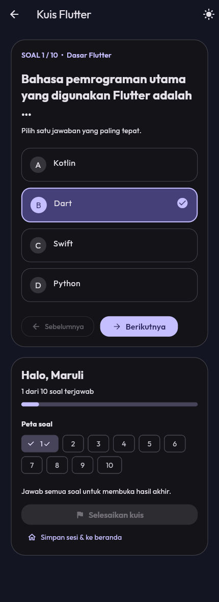
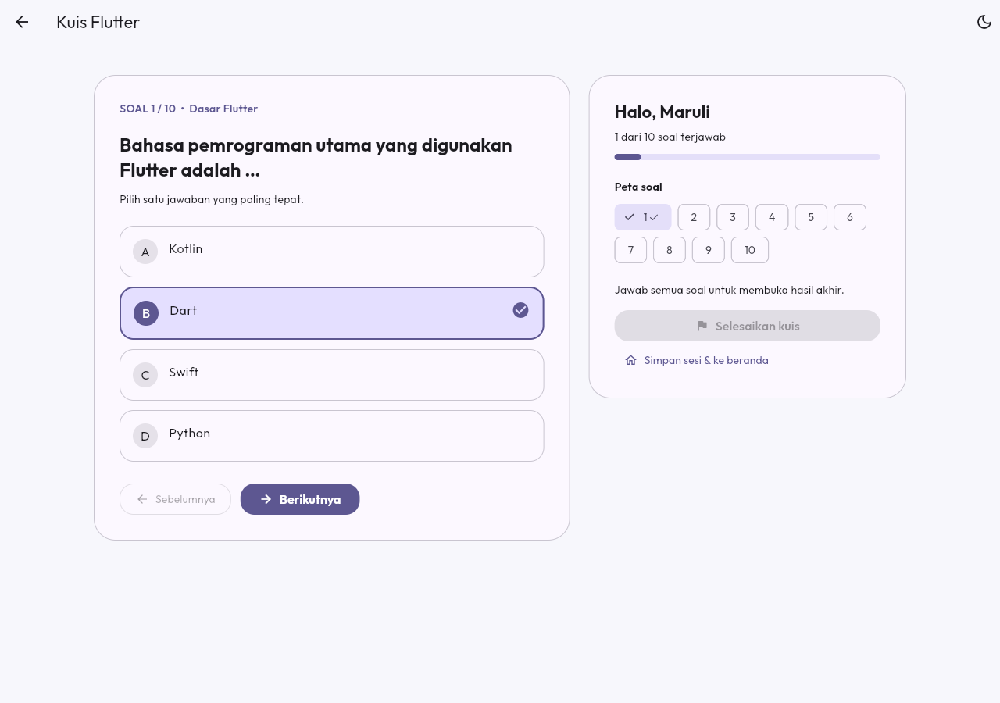

# Quizora

Aplikasi kuis pilihan ganda bertema dasar Flutter untuk UTS Lab Pemrograman Mobile, Universitas Sumatera Utara, semester ganjil 2026/2027.

## Identitas mahasiswa

| Data | Isi |
| --- | --- |
| Nama | Maruli Ricardo Sitanggang (sesuaikan bila berbeda) |
| NIM | **ISI NIM ANDA** |
| Lab | **ISI PM 1 ATAU PM 3 SESUAI KELAS ANDA** |

## Deskripsi dan fitur

Pengguna memasukkan nama, menjawab 10 pertanyaan, dan melihat skor akhir atas namanya. Kuis dapat dijalankan tanpa koneksi setelah aplikasi terpasang.

- Validasi nama, satu pilihan jawaban per soal, navigasi maju/mundur dan peta nomor soal.
- Progress bar dan indikator jumlah soal terjawab.
- Jawaban dapat diubah sebelum dikumpulkan; hasil dibuka setelah seluruh soal terisi.
- Skor 0–100, jumlah benar/salah, pembahasan setiap soal dan coba lagi.
- Beranda menyediakan tombol melanjutkan sesi yang belum selesai.
- Mode terang/gelap dan layout satu/dua kolom sesuai lebar layar.
- Font Outfit dan gambar logo lokal; tanpa paket runtime eksternal di luar Flutter.

## Menjalankan di Android Studio

Buka [panduan lengkap](docs/PANDUAN_ANDROID_STUDIO.md). Ringkasnya:

1. Ekstrak ZIP lalu **File > Open** dan pilih folder `quizora` yang memuat `pubspec.yaml`.
2. Pastikan plugin Flutter dan Dart serta Flutter SDK terpasang.
3. Jalankan `flutter pub get` di terminal dari folder tersebut.
4. Pilih emulator atau perangkat Android, buka `lib/main.dart`, lalu klik Run.

Baseline konfigurasi Android mengikuti versi Gradle/AGP/Kotlin template Flutter 3.38.5: Gradle 8.14, AGP 8.11.1, Kotlin 2.2.20 dan Java target 17. Gunakan Flutter 3.38.5 atau stable yang kompatibel. Persyaratan Dart pada source adalah >=3.5.0 <4.0.0.

## Arsitektur

`QuizoraApp` memiliki satu `QuizController` di atas Navigator. `QuizScope` (InheritedNotifier) membagikan state kepada seluruh halaman. Perubahan jawaban memanggil `notifyListeners()` untuk memperbarui tampilan.

| Folder | Tanggung jawab |
| --- | --- |
| `lib/models` | Struktur satu soal |
| `lib/data` | Bank 10 soal lokal beserta jawaban dan pembahasan |
| `lib/state` | Nama, jawaban, posisi soal, skor, status selesai dan tema |
| `lib/core` | Pengaturan tema global |
| `lib/screens` | Beranda, kuis, hasil dan pembahasan |
| `lib/widgets` | Komponen UI yang digunakan berulang |

Lihat [struktur folder lengkap](docs/STRUKTUR_FOLDER.md) dan [penjelasan kode/presentasi](docs/PRESENTASI_DAN_KODE.md).

State dipertahankan saat route berpindah dan layar berotasi selama proses aplikasi masih hidup. Memulai sesi baru, hot restart atau menutup paksa aplikasi menghapus sesi. Proyek tidak menggunakan database atau penyimpanan permanen.

Layout memakai `LayoutBuilder`, ukuran relatif, pembatas lebar maksimum dan scroll. Breakpoint 760 logical pixels mengubah tampilan menjadi dua kolom. Nilai tetap untuk spacing, radius dan ukuran huruf adalah token desain; ukuran keseluruhan halaman tidak dikunci ke ukuran satu ponsel.

## Pemetaan ketentuan UTS

| Ketentuan | Implementasi |
| --- | --- |
| StatelessWidget dan StatefulWidget | `AnswerOption`/`QuizScreen`, `HomeScreen`/`QuizoraApp` |
| Minimal dua halaman dan navigasi | Empat route: `/`, `/quiz`, `/result`, `/review` |
| Widget reusable dalam file terpisah | Tujuh komponen dalam `lib/widgets` |
| Aset gambar/ikon | Logo PNG lokal dan Material Icons |
| Font kustom | Tiga bobot Outfit pada `assets/fonts` |
| Ukuran UI dinamis | `ResponsivePage`, layout satu/dua kolom, Wrap dan scroll |
| State management | ChangeNotifier + InheritedNotifier di atas Navigator |
| Data lokal, tanpa database | `question_bank.dart` |
| Pelacakan perubahan | Riwayat commit lokal disertakan; push ke GitHub Anda masih perlu dilakukan |
| Bonus dual-theme | `ThemeToggle`, `theme`, `darkTheme`, `themeMode` |
| Bonus tablet/browser | Layout responsif dan runner web |

## Dokumentasi pengumpulan

- [Mockup empat halaman](docs/mockup.svg) — desain referensi, **bukan screenshot aplikasi yang telah dijalankan**.
- Screenshot aplikasi: **belum diambil**; ikuti [daftar screenshot](docs/screenshots/README.md) lalu masukkan hasil asli ke folder tersebut.
- Video presentasi Google Drive (maksimal 10 menit): **ISI TAUTAN VIDEO ANDA**.
- [Alur video dan penjelasan kode](docs/PRESENTASI_DAN_KODE.md).
- [Checklist sebelum mengumpulkan](docs/CHECKLIST_PENGUMPULAN.md).

Setelah screenshot tersedia, tambahkan ke README, misalnya:

```md






```

## Credit aset dan referensi

- Logo Quizora: dibuat khusus untuk proyek ini dengan bentuk geometris dan huruf Q; aset ada di `assets/images/quizora_mark.png`.
- Font **Outfit**, [Google Fonts](https://github.com/google/fonts/tree/main/ofl/outfit); lisensi SIL Open Font License ada di `assets/fonts/OFL.txt`. Font statis diturunkan dari font variabel resmi.
- Material Icons: bawaan Flutter, [Material Design Icons](https://github.com/google/material-design-icons), lisensi Apache 2.0.
- Scaffold Android diadaptasi dari template Flutter; lisensi BSD ada di `docs/FLUTTER_LICENSE.txt`.
- [State management Flutter](https://docs.flutter.dev/data-and-backend/state-mgmt/simple), [font lokal](https://docs.flutter.dev/cookbook/design/fonts), dan [Android Studio](https://docs.flutter.dev/tools/android-studio).
- Penyusunan kode dan dokumentasi dibantu ChatGPT. Pahami, periksa, dan sesuaikan proyek serta cantumkan bantuan sesuai ketentuan kelas.

## Status verifikasi

Pemeriksaan statis offline memakai Dart analyzer 3.5.4 dengan SDK Flutter 3.24.5: **No issues found** untuk source dan test. Formatting Dart telah diterapkan.

Unit test dan widget test disediakan di `test/`, tetapi **belum dieksekusi**. Flutter startup di lingkungan penyusunan dihentikan pemeriksaan otomatis karena mencoba mengakses endpoint metadata internal. Build APK, pengujian emulator, responsivitas visual dan uji runtime perlu dilakukan di komputer Anda. Mockup tidak menggantikan uji aplikasi.

```bash
flutter pub get
flutter analyze
flutter test
flutter run
```

## GitHub

Folder `.git` berisi commit yang benar-benar dibuat selama penyusunan proyek. Author awal adalah `Quizora Project`, bukan klaim aktivitas akun mahasiswa. Jangan hapus folder tersebut jika ingin mempertahankan histori.

Buat repository kosong pada akun GitHub sendiri tanpa README awal, lalu jalankan:

```bash
git config user.name "NAMA GITHUB ANDA"
git config user.email "EMAIL GITHUB ANDA"
git branch -M main
git remote add origin https://github.com/USERNAME/quizora.git
git push -u origin main
```

Ganti `USERNAME` dan identitas dengan milik Anda. Setelah mengisi NIM/lab dan menambahkan screenshot asli:

```bash
git add README.md docs/
git commit -m "docs: add student identity and actual app screenshots"
git push
```

Lanjutkan commit pada setiap fitur/perbaikan yang Anda kerjakan. Tidak ada repository GitHub yang dibuat atau diunggah oleh paket ini. Setelah selesai, kumpulkan URL repository di Google Classroom. Deadline pada soal: **23 Oktober 2026 pukul 20.00 WIB**.
