<div align="center">
  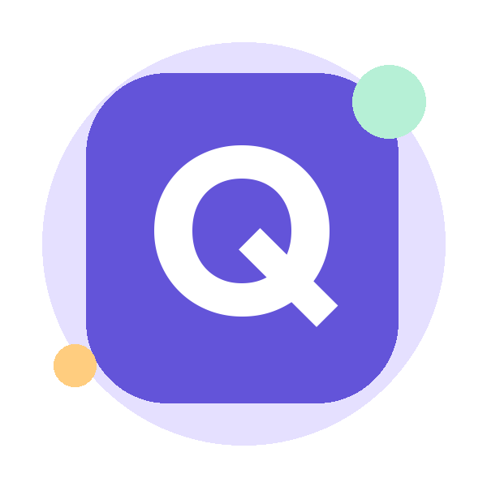
  <h1>Quizora</h1>
  <p><strong>Satu kuis. Selangkah lebih tahu.</strong></p>
  <p>Aplikasi kuis dasar Flutter dengan 10 soal, skor akhir, dan pembahasan jawaban.</p>
  <p>Flutter · Dart · Material 3 · Light &amp; Dark Mode</p>
</div>

---

## Identitas Mahasiswa

| Data | Keterangan |
| --- | --- |
| Nama | Maruli Ricardo Sitanggang |
| NIM | 241401005 |
| Kelas Lab | PM 3 |
| Mata Kuliah | Lab Pemrograman Mobile |
| Universitas | Universitas Sumatera Utara |
| Semester | Ganjil 2026/2027 |
| Repository | [UTS_Pemograman-Mobile](https://github.com/MaruliRicardoSitanggang/UTS_Pemograman-Mobile) |

## Tentang Aplikasi

Quizora adalah aplikasi kuis sederhana. Pengguna memasukkan nama, menjawab sepuluh pertanyaan pilihan ganda tentang dasar Flutter, lalu melihat skor dan mempelajari pembahasan setiap soal.

Materi kuis meliputi Dart, widget, navigasi, layout, aset, state management, responsivitas, siklus hidup, dan tema. Data soal, font, serta logo disimpan secara lokal sehingga aplikasi Android dapat digunakan tanpa koneksi setelah terpasang.

## Fitur Utama

| Fitur | Implementasi |
| --- | --- |
| Nama pengguna | Validasi nama wajib diisi, maksimal 40 karakter; nama muncul pada kuis dan hasil |
| 10 soal pilihan ganda | Setiap soal memiliki empat opsi dan satu jawaban benar |
| Navigasi soal | Tombol Sebelumnya/Berikutnya dan peta nomor soal |
| Progres jawaban | Progress bar, jumlah soal terjawab, dan tanda centang pada peta soal |
| Ubah jawaban | Pilihan dapat diganti sebelum jawaban dikumpulkan |
| Penyelesaian kuis | Tombol aktif setelah 10 soal terjawab, dilanjutkan dialog konfirmasi |
| Skor akhir | Nilai 0–100, jumlah benar/salah, dan pesan sesuai hasil |
| Pembahasan | Status benar/salah, jawaban pengguna, kunci, dan penjelasan setiap soal |
| Coba lagi & lanjutkan sesi | Mengulang kuis atau melanjutkan progres dari beranda |
| Mode terang/gelap | Tema dapat diganti dari tombol bulan/matahari pada app bar |
| Layout responsif | Satu kolom pada layar sempit dan dua kolom mulai lebar 760 logical pixels |

Sesi disimpan dalam memori selama aplikasi masih berjalan. Navigasi antarhalaman dan perubahan orientasi mempertahankan jawaban; hot restart, menutup paksa aplikasi, atau memulai sesi baru menghapus sesi sebelumnya.

## Arsitektur & Teknologi

```text
lib/
├── main.dart                   # Titik awal: runApp(QuizoraApp)
├── app.dart                    # MaterialApp, controller, tema, dan route
├── core/
│   └── app_theme.dart          # Konfigurasi tema terang/gelap
├── data/
│   └── question_bank.dart      # Bank 10 soal lokal dan pembahasan
├── models/
│   └── question.dart           # Model pertanyaan
├── state/
│   ├── quiz_controller.dart    # Nama, jawaban, progres, skor, dan tema
│   └── quiz_scope.dart         # InheritedNotifier untuk berbagi state
├── screens/
│   ├── home_screen.dart        # Beranda dan form nama
│   ├── quiz_screen.dart        # Soal, opsi jawaban, dan peta soal
│   ├── result_screen.dart      # Skor dan ringkasan hasil
│   └── review_screen.dart      # Pembahasan setiap jawaban
└── widgets/
    ├── answer_option.dart     # Opsi jawaban yang dapat dipilih
    ├── app_card.dart          # Kartu konten
    ├── primary_button.dart    # Tombol utama
    ├── responsive_page.dart   # Scroll dan layout sesuai lebar layar
    ├── stat_chip.dart         # Label informasi ringkas
    └── theme_toggle.dart      # Pengubah tema
```

`QuizController` menggunakan `ChangeNotifier`. `QuizScope` membagikannya lewat `InheritedNotifier` di atas Navigator, sehingga jawaban tetap tersedia saat berpindah halaman. `main.dart` hanya menjalankan `QuizoraApp`; pengaturan aplikasi berada di `app.dart`.

| Teknologi | Versi / konfigurasi | Kegunaan |
| --- | --- | --- |
| Flutter | 3.47.2, SDK verifikasi lokal | Framework antarmuka |
| Dart | 3.13.2, bawaan SDK verifikasi | Bahasa pemrograman; batas source `>=3.5.0 <4.0.0` |
| Material 3 | Bawaan Flutter | Komponen, warna, dan tema |
| State management | ChangeNotifier + InheritedNotifier | Pengelolaan sesi kuis |
| Outfit | Regular, SemiBold, Bold | Font kustom dari aset lokal |
| Gradle | 9.3.1 | Build Android; sudah diuji dengan JDK 25 |
| Android Gradle Plugin | 8.11.1 | Konfigurasi build aplikasi Android |
| Kotlin | 2.2.20 | Runner native Android |
| Java target | 17 | Target kompilasi Java/Kotlin |

Dependency aplikasi adalah Flutter SDK; pengujian menggunakan `flutter_test`. Konfigurasi lengkap ada di [pubspec.yaml](pubspec.yaml).

## Screenshot Aplikasi

Semua gambar berikut diambil langsung dari Quizora yang berjalan melalui Flutter Web di Chrome pada **23 Oktober 2026**. Browser menggunakan viewport portrait, tablet, dan landscape. Nama pengguna pada sesi demonstrasi adalah **Maruli**. Detail ukuran dan skenario tersedia di [dokumentasi screenshot](docs/screenshots/README.md).

### Welcome Screen — Beranda

| Light Mode | Dark Mode |
| :---: | :---: |
|  | 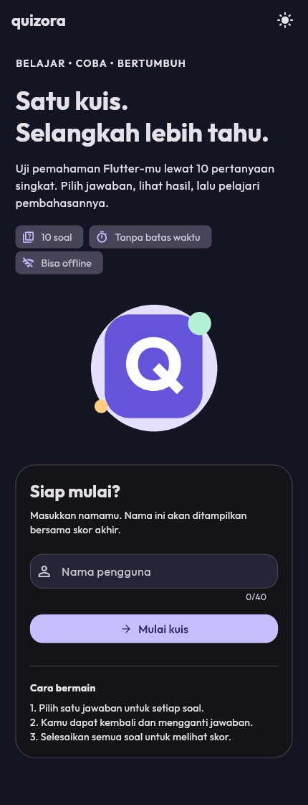 |

### Quiz Screen — Mengerjakan Soal

| Sebelum Menjawab | Setelah Memilih Jawaban | Dark Mode |
| :---: | :---: | :---: |
| 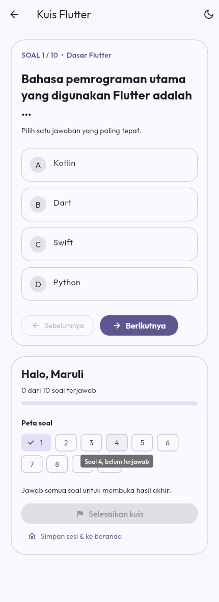 | 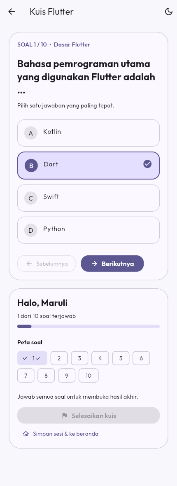 |  |

Pilihan aktif ditandai warna dan ikon centang. Status benar/salah beserta pembahasan ditampilkan setelah kuis dikumpulkan.

### Mengumpulkan Jawaban

| Seluruh Soal Terjawab | Konfirmasi Selesai |
| :---: | :---: |
| 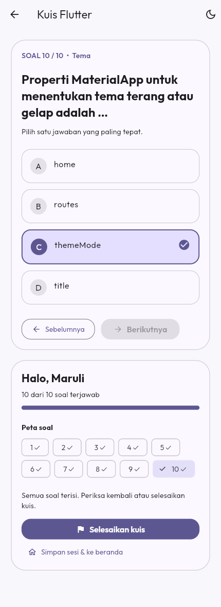 | 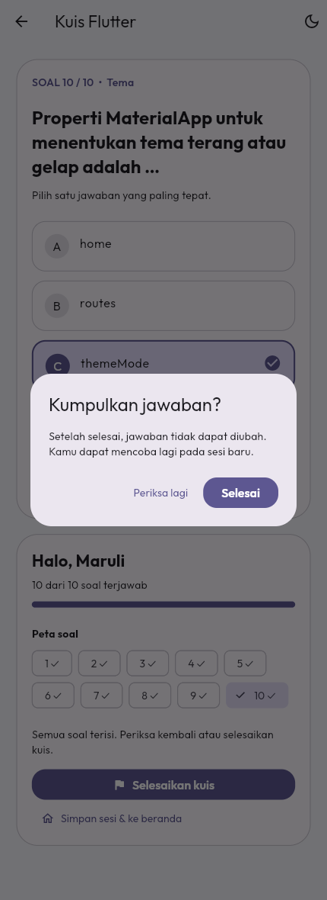 |

Jika tombol **Selesaikan kuis** masih abu-abu, periksa nomor soal yang belum memiliki tanda centang pada peta soal, lalu lengkapi jawabannya.

### Result Screen — Hasil Kuis

| Skor Tinggi — 100 | Skor Rendah — 30 | Dark Mode — 100 |
| :---: | :---: | :---: |
| 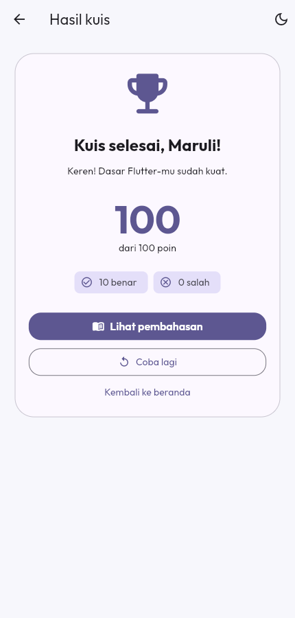 | 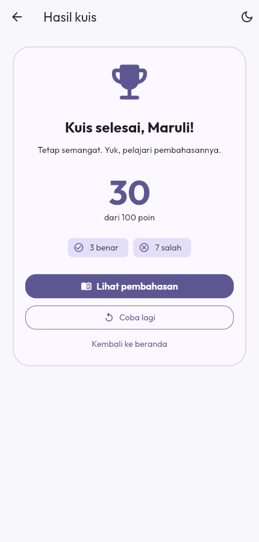 | 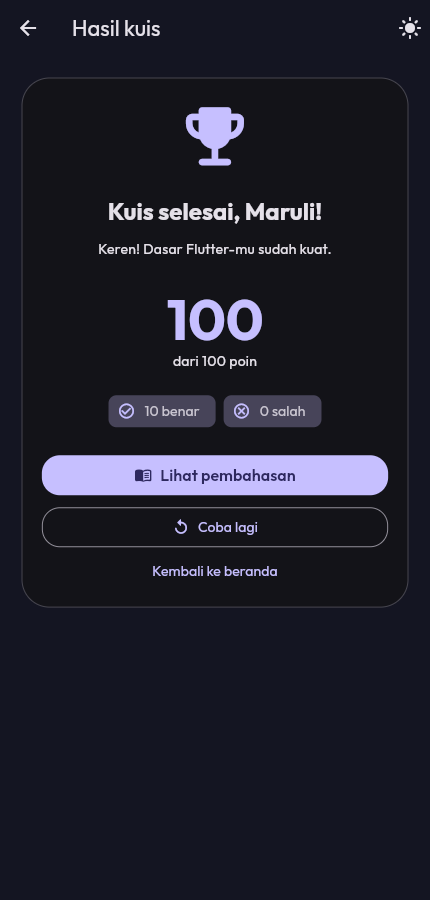 |

Skor dihitung dengan rumus `(jumlah benar / jumlah soal) × 100`. Pada bank soal saat ini, setiap jawaban benar bernilai 10 poin.

### Review Screen — Pembahasan

| Jawaban Benar | Jawaban Salah | Dark Mode |
| :---: | :---: | :---: |
|  | 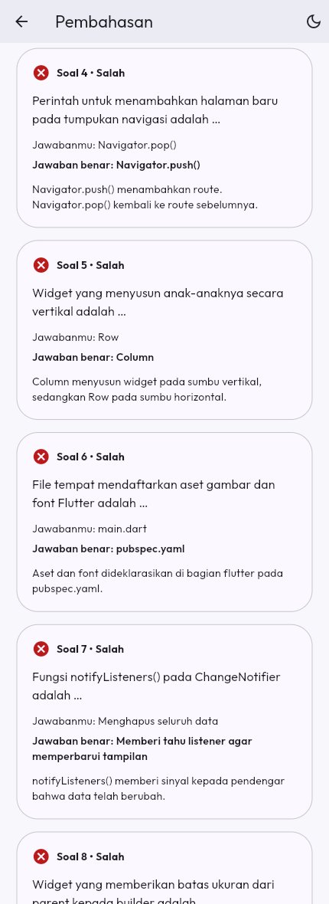 | 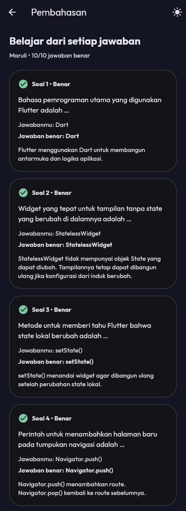 |

Halaman pembahasan dapat digulir untuk melihat seluruh sepuluh soal. Setiap kartu menampilkan pilihan pengguna, jawaban benar, dan penjelasan materi.

### Tampilan Responsif

**Viewport tablet — 1280 × 900:** soal dan navigasi ditampilkan berdampingan.


**Viewport landscape — 1024 × 720:** pilihan jawaban dan progres tetap tersimpan saat ukuran layar berubah.

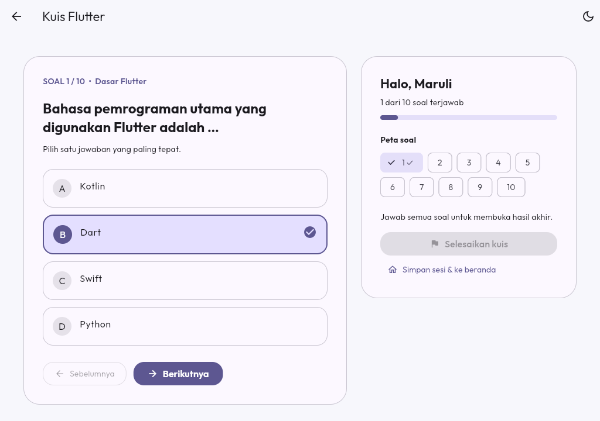

## Alur Penggunaan

1. Buka Quizora, masukkan nama, lalu tekan **Mulai kuis**.
2. Pilih satu opsi pada setiap soal. Gunakan **Sebelumnya**, **Berikutnya**, atau nomor pada **Peta soal** untuk berpindah.
3. Untuk berhenti sementara, tekan **Simpan sesi & ke beranda**; gunakan **Lanjutkan progres** untuk kembali selama aplikasi masih berjalan.
4. Setelah **10 dari 10 soal terjawab**, tekan **Selesaikan kuis**, lalu **Selesai** pada dialog konfirmasi.
5. Lihat skor, jumlah benar/salah, dan pilih **Lihat pembahasan** untuk belajar dari hasilnya.
6. Gunakan **Coba lagi** untuk memulai ulang. Tema dapat diganti melalui ikon bulan/matahari.

## Cara Menjalankan Aplikasi

### Prasyarat

- Flutter SDK; proyek sudah diverifikasi menggunakan **Flutter 3.47.2**.
- Android Studio dengan plugin Flutter/Dart, atau editor dengan dukungan Flutter.
- Android SDK dan JDK yang kompatibel dengan Gradle 9.3.1; build lokal sudah berhasil menggunakan **JDK 25**.
- Emulator atau HP Android dengan USB debugging. Chrome dapat digunakan untuk menjalankan versi web.

### Langkah-langkah

```bash
# 1. Clone repository
git clone https://github.com/MaruliRicardoSitanggang/UTS_Pemograman-Mobile.git
cd UTS_Pemograman-Mobile

# 2. Pasang dependency
flutter pub get

# 3. Periksa toolchain dan perangkat
flutter doctor
flutter devices

# 4. Jalankan aplikasi pada perangkat yang dipilih
flutter run
```

Di Android Studio, buka folder yang memuat `pubspec.yaml`, pilih perangkat, lalu buka **`lib/main.dart`** dan tekan **Run**. Panduan terperinci tersedia di [Panduan Android Studio](docs/PANDUAN_ANDROID_STUDIO.md).

Untuk browser:

```bash
flutter run -d chrome
```

Untuk membuat APK debug:

```bash
flutter build apk --debug
```

APK tersimpan di `build/app/outputs/flutter-apk/app-debug.apk`. Hasil build dan konfigurasi SDK lokal diabaikan oleh Git. Konfigurasi signing saat ini ditujukan untuk tugas/demonstrasi.

## Pengujian & Verifikasi

| Pemeriksaan | Hasil verifikasi 23 Oktober 2026 |
| --- | --- |
| `flutter analyze` | Lulus, **No issues found** |
| `flutter test` | **4 test lulus**, mencakup controller dan widget |
| `flutter build apk --debug` | Build APK Android berhasil |
| Eksekusi browser | Aplikasi berjalan dan 15 screenshot diambil dari UI sebenarnya |
| Sesi skor tinggi | 10 benar, 0 salah, skor **100** |
| Sesi skor rendah | 3 benar, 7 salah, skor **30** |
| Tema dan responsivitas | Mode terang/gelap, portrait, tablet, dan landscape didokumentasikan |

```bash
flutter analyze
flutter test
```

Unit test memeriksa validasi nama, progres, perubahan jawaban, skor 0/100, penguncian jawaban setelah selesai, dan reset. Widget test memeriksa validasi form, navigasi, jawaban setelah perubahan ukuran layar, halaman hasil/pembahasan, dan pergantian tema.

## Credit & Sumber Aset

| Aset | Sumber | Lisensi / keterangan |
| --- | --- | --- |
| [Logo Quizora](assets/images/quizora_mark.png) | Dibuat khusus untuk proyek Quizora | Aset lokal berupa bentuk geometris dan huruf Q |
| Font **Outfit** | [Google Fonts — Outfit](https://github.com/google/fonts/tree/main/ofl/outfit) | [SIL Open Font License](assets/fonts/OFL.txt); tersedia dalam tiga bobot lokal |
| Ikon Material | [Material Design Icons — Google](https://github.com/google/material-design-icons) | Apache 2.0, melalui Material Icons Flutter |
| Scaffold Flutter/Android | Template Flutter | [Lisensi BSD Flutter](docs/FLUTTER_LICENSE.txt) |
| Screenshot aplikasi | Quizora yang berjalan di Chrome | Dokumentasi eksekusi aplikasi milik proyek ini |

Penyusunan kode dan dokumentasi dibantu ChatGPT. Pahami dan sesuaikan implementasi serta cantumkan bantuan sesuai ketentuan kelas.

## Tautan Penting

| Dokumentasi | Tautan |
| --- | --- |
| Video presentasi | https://drive.google.com/drive/folders/1mnxiZ0FEfiI_8prJP_7sckwkHBYWbRW1 |

---

<div align="center">Dibuat dengan Flutter oleh Maruli Ricardo Sitanggang.</div>
